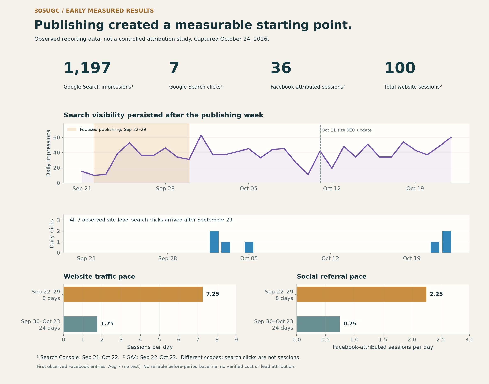
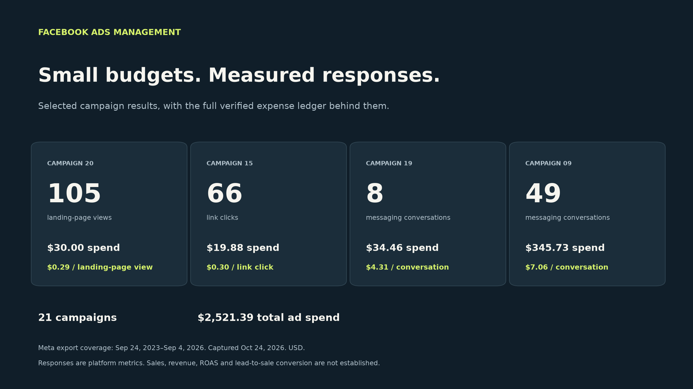

# Joseph Edwards · Marketing, SEO & Performance

I connect service messaging, published content, landing experiences and campaign reporting. The cases show actual observed activity with clear dates, channel definitions, and the limits of attribution. The 305UGC search report captures pre-sale first-launch preparation: organic discovery work before a full launch, not an active paid campaign or conversion study.

[Profile](https://github.com/RawPowered/RawPowered) · [Case walkthrough](docs/WALKTHROUGH.md) · [Evidence scope](docs/EVIDENCE.md) · [Next evidence to add](docs/ROADMAP.md) · [LinkedIn](https://www.linkedin.com/in/josephedwardscto/)

## Start here

| Case | What to inspect | Evidence boundary |
|---|---|---|
| [305UGC — pre-sale organic search and early measurement](https://github.com/RawPowered/305UGC-Showcase/blob/main/docs/MEASURED-RESULTS.md) | 12 guides, a public guides hub, scoped Search Console and GA4 observations, with source report captures. | No paid campaigns were active in this reporting window. Early sample; no causal SEO uplift, tracked calls, qualified-lead count or ROI is established. |
| [Facebook Ads — verified accessible account](https://github.com/RawPowered/Facebook-Ads-Management-Showcase) | 21 export rows, $2,521.39 platform spend, selected copy approaches and cost per platform-reported response. | One accessible account only; results are clicks/views/conversations, not verified sales or ROAS. |
| [RoofRoofTexas — local-search foundations](https://github.com/RawPowered/RoofRoofTexas-Rebuild) | Public rebuild case describes local SEO structure, service content, structured data, sitemap and crawler files. | Technical deliverables and reported claims are distinguished; the public case is not an independent rank study. |

## In view

## Paid campaign overview

This is a separate historical Meta export, not the 305UGC pre-sale reporting window. Its platform-reported responses are not attributed to the organic search case.

The complete [Facebook Ads Management Showcase](https://github.com/RawPowered/Facebook-Ads-Management-Showcase) holds the accessible 21-record expense ledger, individual campaign detail, copy adaptations and methodology.

## Working approach

Clarify the user and business goal, identify the evidence source, make the interface and system boundary explicit, and document what was checked and what remains. These cases separate measured outcomes, implementation observations, private-source summaries and proposed follow-up work.

## More detail

[Open the case walkthrough](docs/WALKTHROUGH.md) for design and delivery rationale. [Review evidence, measurement limits, privacy and status](docs/EVIDENCE.md).

The snapshots are dated, channel-specific observations. They do not isolate marketing causality or establish sales efficiency. Historical owner context includes untracked manual phone calls after people found local businesses through Google, and older campaigns that routed traffic to third-party landing pages no longer available for review. This helps explain why the surviving reports do not show the full customer path; it does not prove or quantify conversions. The ongoing schedule, backlink acquisition, live LLM/bot files and complete conversion attribution need fresh evidence before being stated as complete.

**Available for full-time and contract work.** [Connect on LinkedIn](https://www.linkedin.com/in/josephedwardscto/).
