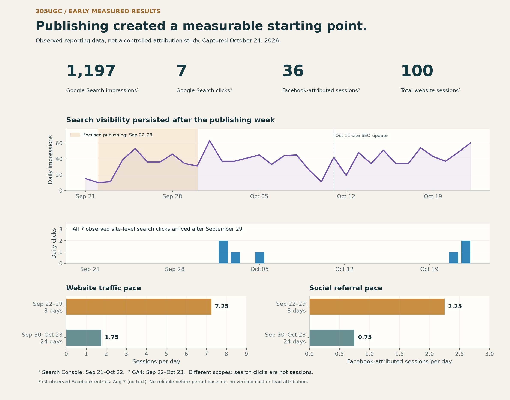

# Measurement case: pre-sale organic search and separate historic paid records

This is a compact reading of the original [305UGC measured-results record](https://github.com/RawPowered/305UGC-Showcase/blob/main/docs/MEASURED-RESULTS.md), captured October 24, 2026. The source files retain the original reporting windows and screenshots.

## What was observed

| Channel / measure | Observed result | Window and limit |
|---|---:|---|
| Google Search impressions | 1,197 | Search Console, Sep 21–Oct 22, 2026 |
| Google Search clicks | 7 | Same property scope; 0.58% calculated CTR, average position 46.3 |
| GA4 sessions | 100 | Sep 22–Oct 23; 55 engaged; internal traffic exclusion not verified |
| GA4 Facebook-attributed sessions | 36 | 35 tagged social + 1 mobile referral; 24 engaged |
| GA4 Google organic sessions | 3 | Distinct measure from Search Console clicks |
| Tracked GA4 key events | 0 | Reported tracking result, not evidence that no inquiries occurred |

## Reporting context

The 305UGC window was pre-sale first-launch preparation. There were no active paid campaigns during this reporting period. Search Console records organic search while the site was used to establish initial traffic, capture natural interest and build an early authority base ahead of full launch. GA4's Facebook-attributed sessions are a separate source classification and do not establish paid delivery.

The public content inventory included twelve guides dated September 22–29. Eleven article URLs appeared in the inspected Search Console Pages table, with 94 page-level impressions and one click. Site totals must not be attributed to the blog alone.

During the eight-day publishing interval GA4 recorded 58 sessions and 42 engaged sessions. In the following period it recorded 42 sessions and 13 engaged sessions. Search impressions continued after publication: seven site-level clicks landed after September 29. These small, non-controlled periods do not prove that publication caused the changes.

## Why calls and conversions are not in these totals

Historical owner-reported context is that people often found local businesses through Google, then manually dialed the listed phone number. Calls that bypassed ad links or call-monitoring numbers were not consistently attributed to a source. Some older campaigns also routed people to third-party landing pages that are no longer available for review. This context explains a measurement gap; it does not validate a specific call, lead, sale or ROI. The surviving analytics show on-site behavior and tracked events only.

## Separate historical paid-social record: response cost and expense context

The separate accessible Meta export covers 21 historic campaign records and $2,521.39 in reported delivery spend. It is not part of the 305UGC pre-sale reporting window. Examples include $19.88 / 66 link clicks ($0.30 per click), $30.00 / 105 landing-page views ($0.29 per view), and $34.46 / 8 messaging conversations ($4.31 per conversation). Campaign objectives differ. The [Ads repository](https://github.com/RawPowered/Facebook-Ads-Management-Showcase) keeps all accessible expenses and the anonymization method inspectable.

These data establish unit cost per platform-reported response only. They do not establish confirmed sales, revenue, return on ad spend, cost per qualified lead, or a company count. The two public copy examples are anonymized adaptations, not verbatim ads; historical results belong to the full campaigns and cannot be assigned to the text alone.

## Technical SEO and content operations

The 305UGC review observed titles/descriptions and sharing metadata, canonical URLs, LocalBusiness/service schema, a reachable sitemap and 12 published guides. It also recorded follow-up needs: inquiry-event tracking, internal traffic exclusions, editorial continuity and a backlink baseline. Historical Buffer queues are not evidence of an active schedule or delivery of every planned post.

The October 24 crawl check found `/llms.txt` and `/bots.txt` returning 404. Replacement assets were prepared in a private build but were not verified deployed at those paths in that snapshot. Do not present those files as live without a new check. The `robots.txt` grouping and sitemap hygiene also had review items.

## Strategy proposals — not reported completed outcomes

1. Keep one editorial calendar with query intent, service fit, reviewer, canonical URL, schema and actual publish date.
2. Track inquiry starts and completed submissions with consent-aware analytics; verify internal-traffic exclusion, use a controlled first-party landing path, and capture phone-source attribution where operationally and legally appropriate before comparing periods.
3. Evaluate backlinks through a dated, permissioned placement ledger. No prior backlink campaign or referring-domain outcome is claimed.
4. Review landing copy and audience against qualified outcomes when CRM attribution is available.
5. Publish a monthly report that keeps spend, traffic, conversion events and revenue in separate measured fields.

## Evidence links

- [305UGC SEO, publishing, crawler-file and accessibility review](https://github.com/RawPowered/305UGC-Showcase/blob/main/docs/SEO-ACCESSIBILITY-AND-DETAIL.md)
- [305UGC project and measurement status](https://github.com/RawPowered/305UGC-Showcase/blob/main/docs/PROJECT-STATUS.md)
- [21-record advertising ledger and method](https://github.com/RawPowered/Facebook-Ads-Management-Showcase/blob/main/docs/METHOD.md)

[Return to overview](../README.md)
